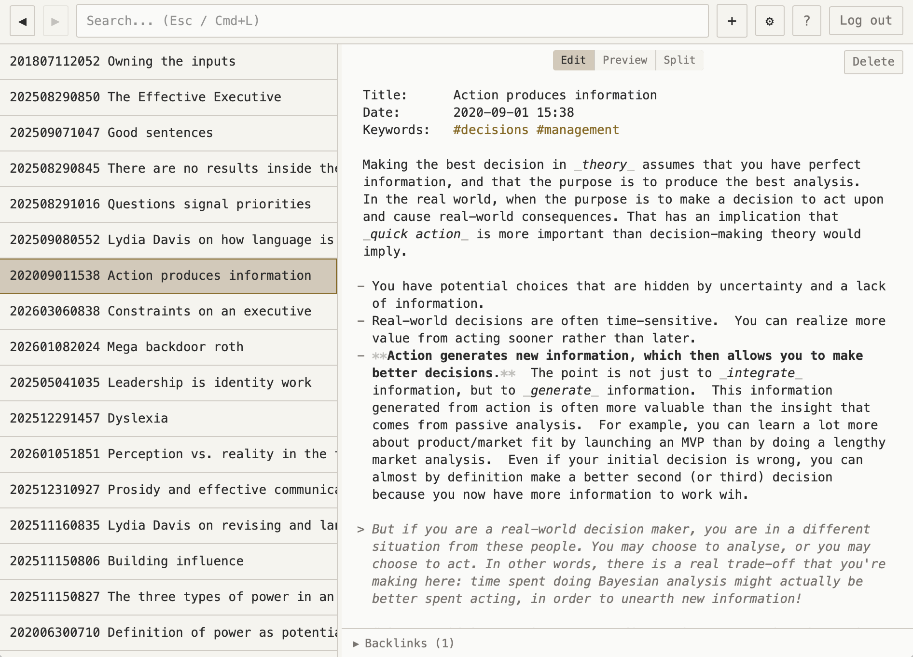

<p align="center">
  
</p>

<h1 align="center">Annex</h1>

<p align="center">A single-user, self-hosted note-taking web app</p>

<p align="center">
  
</p>

Heavily inspired by [The Archive](https://zettelkasten.de/the-archive/) and designed to be used in concert with it. Notes are plain Markdown files on the filesystem with no database. Designed to be accessed from any browser after authenticating with a single password. Uses syncthing in the background to keep notes synced with a local copy on your desktop.

This is the software that I want to use; it is probably not the software that you want to use. 

## Features

- **Plain text notes** — `.md` files with `YYYYMMDDHHMM Title.md` naming convention, fully compatible with The Archive
- **Full-text search** — in-memory Flexsearch index with structured `#tag` / `#reference` filters and search-bar autocomplete
- **Wiki-links, tags, and references** — `[[note links]]`, `#tags`, and Markdown reference citations with autocomplete
- **Live sync** — Syncthing keeps notes in sync between VPS and Mac; SSE pushes external changes to the browser in real time
- **Conflict detection** — etag-based optimistic concurrency prevents overwrites from concurrent edits
- **CodeMirror 6 editor** — Markdown syntax highlighting, auto-save, faded formatting marks, inline link decorations
- **Preview mode** — rendered Markdown with Edit / Preview / Split toggle
- **Backlinks and tags panel** — see what links to the current note and browse all tags
- **Keyboard-driven** — quick open, back/forward navigation, search focus, and more

## Stack

| Layer | Technology |
|-------|------------|
| Backend | Node.js 24, Fastify, TypeScript (tsx) |
| Frontend | React 19, Vite, CodeMirror 6, Tailwind CSS, Zustand |
| Auth | bcrypt + HTTP-only session cookie |
| Search | Flexsearch (server-side, in-memory) |
| Sync | Syncthing (VPS ↔ Mac) |
| Production | DigitalOcean VPS, Caddy (HTTPS), PM2 |

## Getting Started

### Prerequisites

- Node.js 24+
- npm

The `.nvmrc` selects Node.js 24 LTS (`nvm install && nvm use`). Provisioning
also targets Node.js 24; upgrade existing servers before deploying this version.
TypeScript stays on 6.0 until typescript-eslint supports TypeScript 7.

### Setup

```bash
npm install

# Set the login password (first time only)
npm run setup
```

### Development

Start the backend and frontend in separate terminals:

```bash
# Terminal 1 — backend (auto-restarts on change)
NOTES_DIR=~/Documents/TestNotes SESSION_SECRET=devsecretdevsecretdevsecretdevsecret PORT=3001 npm run dev:server

# Terminal 2 — frontend (HMR)
npm run dev
```

Open http://localhost:5173. Vite proxies `/api/*` to the backend on port 3001.

Point `NOTES_DIR` at any folder containing `.md` files — a dedicated test folder is recommended.

### Production Build

```bash
npm run build
NODE_ENV=production NOTES_DIR=/path/to/notes SESSION_SECRET=$(openssl rand -hex 32) npm start
# Open http://localhost:3000
```

## Testing

```bash
# Backend API tests (vitest)
npm test

# End-to-end tests (Playwright)
npm run test:e2e
```

## Search Syntax

The search box supports plain words, exact phrases, negation, and structured hashtag filters:

```text
leadership "effective executive" NOT meeting #drucker1967
```

- Plain words are ANDed across filename, title, and body.
- Quoted phrases match exact text case-insensitively.
- `NOT word` excludes notes containing that word.
- `#key` matches a normal tag, a reference definition like `[#drucker1967]: ...`, or a citation like `[54][#drucker1967]`.
- While typing a `#...` token in the search box, autocomplete suggests both tags and reference keys; choosing one replaces only the current token, so `leadership #dru` can become `leadership #drucker1967`.

## Deployment

The Makefile runs Terraform to manage infrastructure and Ansible to provision the VPS and deploy the app.

Terraform defaults to `debian-12-x64` to match the existing droplet. Set
`droplet_image = "debian-13-x64"` in `terraform/terraform.tfvars` or export
`TF_VAR_droplet_image=debian-13-x64` for a new test droplet with separate Terraform
state. Changing the image in an existing droplet's configuration triggers
replacement. Debian 13 provisioning is pending verification.
[DigitalOcean image catalog](https://docs.digitalocean.com/products/droplets/details/images/)

```bash
# 1. Create the droplet + cloud firewall
make infra-init
make infra-apply

# 2. Pin the new droplet's SSH host key, then provision it
make wait-for-ssh
FIRST_RUN=1 make provision

# 3. Deploy the app
make deploy
```

Copy `deploy.sh.example` to `deploy.sh` and fill in `DIGITALOCEAN_TOKEN`,
`TF_VAR_ssh_key_name`, and `SESSION_SECRET`. Set the required `DOMAIN` to the
HTTPS hostname and point its DNS record at the droplet. Keep the wrapper private with
`chmod 700 deploy.sh`. Keep the same session secret across deployments to
preserve existing sessions. Deployment uses `DOMAIN` for public HTTPS health checks.

Before the first SSH connection, read `/etc/ssh/ssh_host_ed25519_key.pub` from
the trusted DigitalOcean console. Add the droplet IP followed by that public
key on one line in `~/.ssh/known_hosts`. First-time provisioning connects as
`root`. Later provisioning defaults to the key-only `annex-admin` account.

Provisioning applies safe apt upgrades and selects the latest Node.js 24,
Caddy, PM2, and Syncthing packages from the configured channels. Fresh
Syncthing installations use the v2 channel. Existing v1 installations keep
their channel until a planned migration.

Provisioning installs a checksum-verified npm CLI for VPS deployments.
To update its pin, change the version and archive checksum together in
`ansible/group_vars/all.yml`, then provision the host before deploying.

Debian security updates run automatically. The daily `annex-update-status.timer`
reports pending reboots, failed APT jobs, and available Node.js, Caddy, and
Syncthing updates to the VPS journal. Review it with
`sudo journalctl -u annex-update-status.service`. Schedule third-party updates,
service restarts, and reboots during maintenance. Review and update the app's
npm lockfile separately so deployment uses tested dependency versions.

`make deploy` and `make push` both build and audit in an isolated local
directory. The upload contains the compiled server, built client, and npm
manifests. Deployment stops the running app for dependency installation,
then restores the previous release if activation or a health check fails.
If deployment is interrupted or rollback fails, recovery files may remain
in the private staging directory at `/opt/annex/.annex-deploy.lock`.

## Project Structure

```
server/           # Fastify backend (auth, routes, file store, search index, SSE)
src/              # React frontend (components, store, hooks, editor)
ansible/          # Provision + deploy playbooks, Caddyfile template
terraform/        # DigitalOcean droplet + firewall IaC
test/             # Backend API tests (vitest)
e2e/              # End-to-end tests (Playwright)
```

## Setting Up Syncing

After deploying, open **Settings** (gear icon or `Cmd+,`) and scroll to the **Sync (Syncthing)** section.

### One-time setup

1. On your Mac, install Syncthing:
   ```bash
   brew install syncthing
   brew services start syncthing
   ```
2. Open http://localhost:8384 to access the Syncthing GUI on your Mac.
3. In **Annex Settings**, copy the server's Device ID (click "Copy").
4. In the **Mac Syncthing GUI**, go to *Add Remote Device* and paste the server's Device ID.
5. In the **Mac Syncthing GUI**, find your Mac's Device ID under *Actions > Show ID*.
6. Back in **Annex Settings**, paste your Mac's Device ID and click **Pair device**. This adds the Mac as a trusted device and shares the notes folder automatically.
7. In the **Mac Syncthing GUI**, accept the incoming folder share when prompted. Set the local path to your notes folder (e.g., `~/Documents/Zettelkasten`).

### After pairing

- The connection status dot in Settings shows **green** when connected, **yellow** when paired but not currently connected.
- Syncthing uses outbound connections or relays by default. The cloud firewall and UFW keep direct sync and discovery ingress closed.
- iCloud syncs from your Mac to iPhone/iPad as before.

### If Syncthing isn't provisioned

The Sync section will show "Syncthing is not configured on this server." Run `make provision` (or `FIRST_RUN=1 make provision` for a new droplet) to install Syncthing on the VPS first.


## Documentation

- [SPEC.md](SPEC.md) — full application specification
- [CLAUDE.md](CLAUDE.md) — Claude Code development instructions and current status
- [AGENTS.md](AGENTS.md) — Codex entrypoint that delegates to the same project brief
